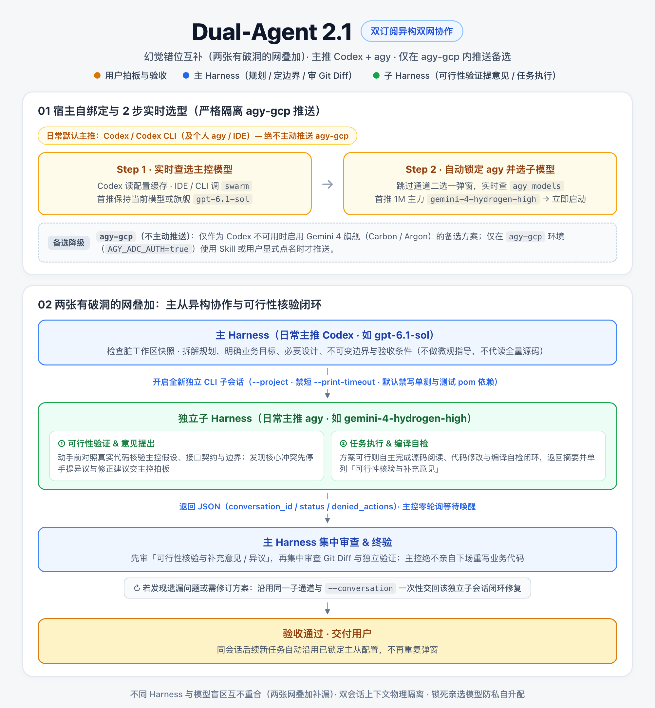

# Dual-Agent 2.1 — 双订阅异构双网协作编排

> **核心理念（「幻觉错位 / 两张有破洞的网叠加」理论）**：不同 Harness（Agent 运行框架）与各家模型家族的思维盲区、疏漏点天然不一致。**日常默认主推 `Codex + agy` 双订阅模式**——主 Harness 负责需求规划、边界把控与 `git diff` 终验，独立子 Harness 负责**可行性验证提意见**与**任务执行自检闭环**，两张网错位叠加、互相兜底。**`agy-gcp` 降级为 Codex 不可用时的 Gemini 4 旗舰备选方案**，在 Codex / Codex CLI 中**绝不主动推送 `agy-gcp`**，仅在 `agy-gcp` 环境中使用本 Skill（或用户显式点名）时才主动推送。

## 核心亮点

- **日常主推 `Codex + agy` 双订阅，防越界推送 `agy-gcp`**：
  - 在 **Codex / Codex CLI**（及个人 `agy` / 个人 Antigravity IDE）中使用时，Skill **绝不主动推送 `agy-gcp`**，直接锁定 `agy` 个人 Pro 作为子通道，走双订阅固定成本 + 跨厂商模型异构互补。
  - 仅当 **Codex 不可用** 或当前直接在 **`agy-gcp` 环境（`AGY_ADC_AUTH=true`）** 中触发 Skill 时，才主动推送 `agy-gcp` 调用 **Gemini 4 旗舰（`Carbon` / `Argon`）** 作为备选方案。
- **主从 Harness 职责互补（规划审核 vs 可行性提意见 + 执行）**：
  - **主 Harness**（主推 Codex `gpt-6.1-sol` 等）：负责规划拆解、定目标/不可变边界/验收条件、审查 `git diff` 与终验，绝不亲自下场重写业务代码。
  - **子 Harness**（主推 `agy` `gemini-4-hydrogen-high` 等）：动手前先对照真实代码做**可行性验证并提出意见**（发现根本冲突立即停手提建议交主控拍板），可行则自主完成编码与编译自检闭环，并单列「可行性核验与补充意见」反馈。
- **宿主自绑定 + 2 步实时选型（同会话自动复用）**：
  1. **Step 1 实时查选主控模型**：Codex 实时读取 `~/.codex/config.toml` 与 `~/.codex/models_cache.json`，Antigravity IDE / `agy` / `agy-gcp` CLI 调内置 `swarm(action="models", all=true)`；
  2. **Step 2 自动锁定子通道并实时查选子模型 $\rightarrow$ 立即开跑**：Codex / 个人环境直接锁定 `agy` 查 `agy models`（不推 `agy-gcp`）；仅 `agy-gcp` 宿主才查 `agy-gcp models`。选定后同会话后续任务与返工自动沿用。
- **双宿主零轮询等待**：Codex 下基于 V8 `while` 循环 + `functions.wait` 持续等待，Antigravity IDE / CLI 下基于后台任务反应式自动唤醒，全程零轮询 Token 浪费。

---

## 一键安装（Codex + Antigravity IDE / CLI 全平台生效）

将 [AGENTS.md](AGENTS.md) 中的分工规则合并到目标项目的 `AGENTS.md`。确认本机已安装并登录 `agy` 后，在本仓库根目录执行：

```bash
# 1. 同步安装 Skill 至 Codex 全局目录与 Antigravity (IDE / App / CLI 共享) 全局目录
mkdir -p ~/.codex/skills/dual-agent ~/.gemini/config/skills/dual-agent
cp dual-agent/SKILL.md ~/.codex/skills/dual-agent/SKILL.md
cp dual-agent/SKILL.md ~/.gemini/config/skills/dual-agent/SKILL.md

# 2. （可选推荐）安装备选通道 agy-gcp 包装脚本与实时彩色看板脚本至 PATH
mkdir -p ~/.local/bin
cp bin/agy-gcp ~/.local/bin/agy-gcp
cp bin/agy-watch ~/.local/bin/agy-watch
```

安装后，在 **Codex**（主推）或 **Antigravity IDE / `agy` / `agy-gcp` CLI** 对话中调用 `$dual-agent` 即可弹出 2 步选型向导开始协作：
- [dual-agent/SKILL.md](dual-agent/SKILL.md)：两张网理论分工、宿主隔离 2 步选型向导、可行性验证提示词与双宿主调度模板。
- [bin/agy-gcp](bin/agy-gcp)：备选通道 GCP Vertex AI ADC 独立可执行包装器（自动解析 `~/.gemini/credentials/gcp-adc.json` 或标准 gcloud ADC 凭证与项目 ID）。
- [bin/agy-watch](bin/agy-watch)：支持跨会话自动热切换的终端实时彩色执行大盘。
- [CHANGELOG.md](CHANGELOG.md)：问题排查取证与版本演进记录。

---

## 推荐搭配与备选降级速览

| 定位 | 所在宿主（自动锁定为主控） | 主 Harness 推荐模型（规划 / 边界 / 审 `git diff`） | 独立子 Harness & 推荐模型（可行性验证提意见 + 执行闭环） | 核心优势 |
| :--- | :--- | :--- | :--- | :--- |
| **日常主推（默认）** | **Codex / Codex CLI**（绝不推送 `agy-gcp`） | 当前窗口旗舰（如 `gpt-6.1-sol`） | **`agy`** + `gemini-4-hydrogen-high`（复杂逻辑可用 `xhigh`） | OpenAI + Google 双订阅异构互补，1M 上下文主力干重活且零按量账单 |
| **同体系隔离** | **Antigravity IDE / 个人 `agy` CLI** | `Gemini 4 Argon (Medium)` 或 `Hydrogen (High)` | **`agy`** + `gemini-4-hydrogen-high`（或跨厂商 `claude-sonnet-5-5-high`） | 旗舰大脑把关、数百步编码隔离在独立 CLI 子会话，不污染主会话且防烧穿周配额 |
| **备选降级（仅 Codex 不可用或处于 `agy-gcp` 时推送）** | **`agy-gcp` CLI**（`AGY_ADC_AUTH=true`） | `gemini-4-carbon-medium` 或 `gemini-4-argon-medium` | **`agy-gcp`** + `gemini-4-hydrogen-high`（或跨厂商 `claude-sonnet-5-5-high`、`gemini-3.8-flash-high`） | Codex 无法使用时的 Gemini 4 旗舰顶替退路，实测 `agy 1.5.9` 已全量直通 Carbon / Hydrogen |

---

## 架构与执行流程（两张有破洞的网叠加）



[查看完整尺寸 PNG](assets/architecture.png)

### 协作四原则

1. **委托前（主 Harness 规划）**：检查脏工作区快照备份，主控讲清楚**业务目标、必要设计、不可变边界和验收条件**，不对子 Harness 做过度限制或微观指导。重大跨服务改造可先派独立只读前置评估。
2. **执行中（子 Harness 核验提意见 + 执行）**：直派全新独立子会话（**禁设短 `--print-timeout`**，默认禁写单测与禁加测试 POM 依赖）。子会话先核验方案可行性（遇根本冲突先停手提意见，可行则直接修改并编译自检），主控零轮询静默等待唤醒。
3. **交付后（主 Harness 审 diff 终验）**：主控核对返回 JSON（`conversation_id`、`status`、`denied_actions`），先审子 Harness 的「可行性核验与补充意见」，再集中审查 `git diff` 并独立验证；发现遗漏一次性交回同一子会话修复。
4. **出现阻塞时**：针对具体阻塞定向处理，主控绝不亲自下场重写业务代码。

---

## 实时查看子会话执行状态（可选彩色大盘）

若想在另一个终端窗口实时观察独立子会话正在调用的工具、修改的文件与思考过程（100% 只读旁路，零侵入）：

### 方式 1：执行仓库内置脚本（推荐，支持跨会话自动热切换与详细模式）
`bin/agy-watch` 基于 Python 纯标准库实现，无需安装 `jq`，**新子会话拉起时自动无缝切换追踪**：
```bash
./bin/agy-watch        # 默认紧凑看板模式（防刷屏）
./bin/agy-watch -v     # 详细模式（不截断长指令，显示完整文件路径、全量命令与执行结果摘要）
./bin/agy-watch -vv    # 全量详细模式（包含命令输出全文）
```

### 方式 2：终端原始单行命令（单会话静态跟踪，免安装）
```bash
tail -n 30 -f "$(ls -t ~/.gemini/antigravity-cli/brain/*/.system_generated/logs/transcript.jsonl | head -n 1)" | jq --unbuffered -r '
  def c_dim(s): "\u001b[90m" + s + "\u001b[0m";
  def c_step(s): "\u001b[1;33m" + s + "\u001b[0m";
  def c_cmd(s): "\u001b[1;32m" + s + "\u001b[0m";
  def c_edit(s): "\u001b[1;35m" + s + "\u001b[0m";
  def c_read(s): "\u001b[1;36m" + s + "\u001b[0m";
  def c_tool(s): "\u001b[1;34m" + s + "\u001b[0m";
  def c_arg(s): "\u001b[37m" + s + "\u001b[0m";
  def c_msg(s): "\u001b[96m" + s + "\u001b[0m";
  def c_user(s): "\u001b[1;45;97m" + s + "\u001b[0m";

  if .type == "USER_INPUT" then
    c_dim("[\(.created_at[11:19])]") + " " + c_user(" 🚀 USER ") + " " + c_msg((.content // "") | gsub("\n"; " ") | .[0:80])
  elif .type == "PLANNER_RESPONSE" then
    c_dim("[\(.created_at[11:19])]") + " " + c_step("#\(.step_index)") + " " +
    (if (.tool_calls | length) > 0 then
      ([.tool_calls[] |
        (if .name == "run_command" then c_cmd(.name)
         elif (.name == "edit_file" or .name == "write_file") then c_edit(.name)
         elif .name == "read_file" then c_read(.name)
         else c_tool(.name) end) +
        "(" + c_arg(
          if .args.Path then (.args.Path | gsub("^\"|\"$"; "") | split("/") | last)
          elif .args.CommandLine then (.args.CommandLine | gsub("^\"|\"$"; "") | .[0:60])
          else (.args.Query // .args.SearchPath // "" | gsub("^\"|\"$"; ""))
          end
        ) + ")"
      ] | join(", "))
    else
      "\u001b[35m💬\u001b[0m " + c_msg((.content // "") | gsub("\n"; " ") | .[0:80])
    end)
  else empty end
'
```
